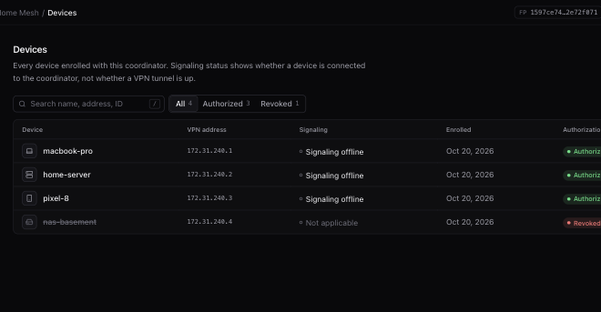

<div align="center">

# MyNet

**A fully self-hosted mesh VPN.** Your coordinator, your devices, your network — no cloud, no accounts, no third-party control plane.

[](https://github.com/gcostello02/mynet/actions/workflows/ci.yml)
[](LICENSE)


</div>

MyNet connects your machines into a private network using **WireGuard** tunnels negotiated peer-to-peer over **ICE** (STUN/TURN), so devices behind home routers reach each other directly — on the LAN, across the internet, or through a relay when NAT gets in the way. A small **coordinator** you host handles enrollment and signaling; it never sees your traffic.

<p align="center">
  
</p>

## Highlights

- **Self-hosted end to end** — one Docker container on a Linux box you control. No MyNet-operated service exists.
- **Direct peer-to-peer** — WireGuard over ICE with hole punching; TURN relay fallback if you configure it.
- **Invite-based enrollment** — one-time, expiring invitations pinned to your coordinator's Ed25519 fingerprint.
- **Admin dashboard + CLI** — manage devices and invitations from the embedded web UI or `mynet admin`.
- **Always-on edge service** — systemd (Linux) and launchd (macOS) supervision; reboots and network changes recover automatically.
- **Small, auditable surface** — Go, SQLite, per-peer `/32` routes, IPv4 only.

## How it works

```
                    ┌──────────────────────────────┐
                    │   Coordinator (Docker, :8080) │
                    │   enrollment · signaling · UI │   ← your HTTPS reverse proxy
                    └───────────────┬──────────────┘
                       HTTPS / WSS  │  (control plane only)
          ┌─────────────────────────┼─────────────────────────┐
          │                         │                         │
   ┌──────┴──────┐           ┌──────┴──────┐           ┌──────┴──────┐
   │  Laptop     │◄─────────►│  Mini PC    │◄─────────►│  Desktop    │
   │ 172.31.240.2│ WireGuard │ 172.31.240.1│ WireGuard │ 172.31.240.3│
   └─────────────┘  over ICE └─────────────┘  over ICE └─────────────┘
                     (direct P2P, TURN fallback)
```

| Component | Runs | Purpose |
|-----------|------|---------|
| **Coordinator** | One per network, on Linux (Docker) | Enrollment, signaling, admin API, SQLite state, Ed25519 identity, embedded dashboard |
| **Edge device** | Every machine you want on the VPN (macOS or Linux) | `mynet` CLI + `mynet-daemon`; WireGuard TUN and per-peer routes |

Devices get addresses from `172.31.240.0/20` by default (configurable via `MYNET_VPN_CIDR`).

## Quick start

You'll need a Linux machine with Docker for the coordinator, a hostname with HTTPS (any reverse proxy), and one or more edge devices.

### 1. Run the coordinator

```bash
git clone https://github.com/gcostello02/mynet.git
cd mynet/deploy/coordinator
cp .env.example .env
# Generate a secret and paste it into .env as MYNET_SERVER_SECRET:
openssl rand -base64 32
docker compose build && docker compose up -d
curl -sf http://127.0.0.1:8080/healthz
```

The coordinator binds to `127.0.0.1:8080`. Point your reverse proxy (nginx, Caddy, Cloudflare Tunnel, …) at it, and set `MYNET_SECURE_COOKIES=true` in `.env` when serving HTTPS. Clients and invitations must use the **same HTTPS URL** you declare in the next step.

Full reference: [deploy/coordinator/README.md](deploy/coordinator/README.md)

### 2. Create the admin account

On the coordinator host (build `mynet` first — see [Build from source](#build-from-source)):

```bash
mynet admin setup \
  --server http://127.0.0.1:8080 \
  --user admin \
  --network "My Network" \
  --public-url https://your-host.example
```

Passwords need at least 12 characters. Setting up remotely? Run `mynet admin bootstrap --server http://127.0.0.1:8080` on the host, then `mynet admin setup --bootstrap-token '…' --server https://…` from your machine. The browser wizard at `https://your-host.example/` works too.

### 3. Invite a device

```bash
mynet admin login --server https://your-host.example --user admin
mynet admin invitations create --label laptop --max-uses 1
```

You can also create invitations from the dashboard (**Invitations → Copy join command**). The invitation string is a one-time secret — treat it like a password.

### 4. Join and connect (on each edge device)

```bash
mynet join --name my-laptop '<invitation>'
sudo mynet service install
sudo mynet service start      # Linux: also enables start at boot
sudo mynet up
mynet status
```

Check what's already there first with `ls ~/.mynet` and `mynet service status` — don't install a second service over an existing one. More detail: [docs/v040-m2-join.md](docs/v040-m2-join.md).

```text
$ mynet status
Device: my-laptop
Virtual IP: 172.31.240.2
WireGuard: Active

PEER     MYNET IP      TRANSPORT    ICE          STATE
minipc   172.31.240.1  Direct P2P   Connected    Transport ready
```

## CLI cheat sheet

| Command | What it does |
|---------|--------------|
| `mynet join --name <device> '<invitation>'` | Enroll this device |
| `sudo mynet up` / `sudo mynet down` | Start / stop the VPN (TUN + routes) |
| `mynet status` | Device, peers, transport (direct vs relayed) |
| `mynet peers` | Peers known to the coordinator and whether they're online |
| `mynet diagnose [--peer <name>]` | Connectivity diagnostics |
| `mynet connect --peer <name> [--relay-only]` | Force a connection attempt |
| `sudo mynet service install\|start\|stop\|uninstall` | Manage the supervised daemon |
| `mynet service status` / `logs` | Daemon health and logs |
| `sudo mynet service upgrade --candidate ./bin/mynet` | Swap in a new binary |
| `mynet admin login\|invitations\|password change` | Administer the network |

Run `mynet` with no arguments for the full list.

## Tips

- **SSH that prefers the LAN, falls back to MyNet** — handy for machines at home that you also reach remotely:

  ```sshconfig
  Host minipc
      HostName 192.168.1.50
      User you
      HostKeyAlias minipc
      ProxyCommand /bin/sh -c 'for ip in 192.168.1.50 172.31.240.1; do if nc -z -G 2 "$ip" 22 >/dev/null 2>&1; then exec nc "$ip" 22; fi; done; echo "minipc unreachable" >&2; exit 1'
  ```

  (On Linux, use `nc -z -w 2` instead of `-G 2`.)
- **Back up the coordinator** — `coordinator.db` and `coordinator.ed25519` must be saved together:

  ```bash
  cd deploy/coordinator
  docker compose exec coordinator tar -czf - -C /data . > backup.tar.gz
  ```
- **Using Tailscale too?** MyNet doesn't modify it. See [docs/tailscale.md](docs/tailscale.md) and [docs/independent-connectivity.md](docs/independent-connectivity.md).
- **Strict NAT or CGNAT?** Run a TURN relay — [docs/turn.md](docs/turn.md), [deploy/coturn](deploy/coturn).

## Troubleshooting

| Symptom | Check |
|---------|-------|
| `/healthz` fails | `docker compose logs coordinator`; is `MYNET_SERVER_SECRET` set in `.env`? |
| Setup says forbidden | Run setup on the host via loopback, or use a bootstrap token for remote HTTPS |
| `join` fails | HTTPS URL matches `--public-url`, invitation not expired or used up, clocks in sync |
| Peers stuck on "Connecting" | `mynet diagnose`; STUN/TURN settings in `.env`; UDP not blocked by a firewall |
| Locked out of admin | Restore a DB backup — there is no cloud recovery |

More: [docs/vpn-troubleshooting.md](docs/vpn-troubleshooting.md) · [docs/connection-diagnostics.md](docs/connection-diagnostics.md) · [docs/m1-coordinator-admin.md](docs/m1-coordinator-admin.md)

## Build from source

Requires the Go version in [`go.mod`](go.mod) (the toolchain downloads automatically) and Node 22 only if you rebuild the dashboard.

```bash
make build            # bin/mynet and bin/mynet-server
make build-dashboard  # rebuild the embedded admin UI (optional; a build is committed)
make test             # go test ./... -race
```

The VPN is IPv4-only with per-peer `/32` routes — see [docs/vpn-setup.md](docs/vpn-setup.md).

## Documentation

| Topic | Docs |
|-------|------|
| Architecture & design | [v040-architecture](docs/v040-architecture.md) · [wireguard-design](docs/wireguard-design.md) · [protocol](docs/protocol.md) |
| Security | [v040-security-model](docs/v040-security-model.md) · [vpn-security](docs/vpn-security.md) |
| Dashboard | [v040-m3-dashboard](docs/v040-m3-dashboard.md) · [first-run setup](docs/v040-m3-first-run-setup.md) |
| Operating | [vpn-setup](docs/vpn-setup.md) · [daemon-lifecycle](docs/daemon-lifecycle.md) · [deployment-options](docs/deployment-options.md) |
| Testing | [testing](docs/testing.md) · [vpn-testing](docs/vpn-testing.md) · [staging harness](docs/m040-m2-staging.md) |

The multi-container acceptance harness lives in [deploy/staging](deploy/staging/) and isn't needed for a normal install.

## License

[MIT](LICENSE) © 2026 Grant Costello. You may use, modify and redistribute MyNet, provided the copyright notice and license text are kept in copies.
