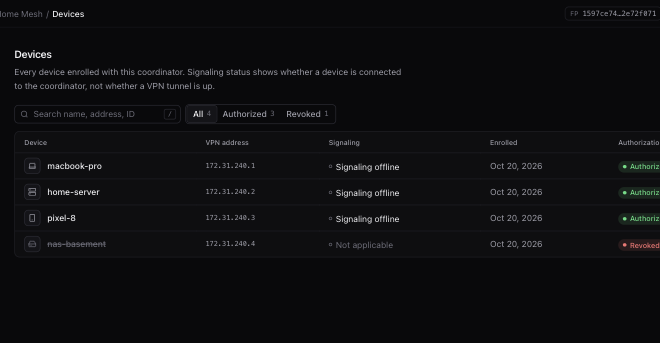

# Admin dashboard and first-run setup

The coordinator embeds a web dashboard, served at `/` from the same listener as the API (`/v1/*`, `/healthz`). There's no separate frontend service, and the UI is optional: everything can be done with `mynet admin`.



## What it does

- **Overview:** network name, registered/authorized devices, signaling-online count and a membership map.
- **Devices:** list, search, details drawer, revoke. (Renaming exists in the API, `PATCH /v1/admin/devices/{id}`, but not yet in the UI.)
- **Invitations:** create (label, expiry, max uses), copy the invitation or a ready-to-run `mynet join` command, revoke.
- **Settings:** network info, coordinator fingerprint, change admin password.
- **Setup wizard** on a fresh coordinator (below).

"Signaling online" means the device holds a WebSocket to the coordinator. It doesn't prove the VPN tunnel is up.

## First-run setup

A new coordinator is uninitialized until an admin account is created once.

### From the coordinator host (loopback)

```bash
mynet admin setup --server http://127.0.0.1:8080 \
  --user admin --network "My Network" --public-url https://your-host.example
```

Loopback requests need no extra proof. This generates the coordinator Ed25519 identity and creates the SQLite state and the first admin. Passwords need at least 12 characters.

### From elsewhere (browser or CLI over HTTPS)

Remote setup needs a **one-time bootstrap token** so that nobody on the internet can initialize your network first.

```bash
# on the coordinator host (also printed in the coordinator log at startup)
mynet admin bootstrap --server http://127.0.0.1:8080
# then, from any machine
mynet admin setup --server https://your-host.example --bootstrap-token '<token>' \
  --user admin --network "My Network" --public-url https://your-host.example
```

The token is valid for 2 hours, is cleared when setup succeeds, and can only be fetched over loopback. A new one is issued on each coordinator start until setup completes. You can also open `https://your-host.example/` and follow the wizard: paste the token, choose the network name and admin credentials, copy the coordinator fingerprint, create the first invitation, and follow the join instructions. The wizard keeps the token and invitation only in page memory.

Setup is blocked when the network is already initialized or devices are already enrolled. For automation, `MYNET_SETUP_TOKEN` provides a static remote setup token (prefer the one-time bootstrap).

| Method | Path | Auth |
|--------|------|------|
| GET | `/v1/setup/status` | none; returns `initialized`, `bootstrap_active`, `bootstrap_expires_at` |
| GET | `/v1/setup/bootstrap` | loopback only |
| POST | `/v1/admin/setup` | loopback, `X-Mynet-Bootstrap-Token`, or setup token |

## Browser sessions

- HttpOnly `SameSite=Strict` cookie (`mynet_admin_session`, 12 h), `Secure` when `MYNET_SECURE_COOKIES=true`.
- CSRF: mutating requests carry `X-Mynet-CSRF` matching the `mynet_csrf` cookie.
- Admin sessions live in memory, so a coordinator restart signs everyone out.

Run the coordinator behind an HTTPS reverse proxy on the same host as the API (same origin). The full security notes are in [security.md](security.md).

## Developing the UI

The UI is React + TypeScript + Vite + Tailwind in [`web/admin`](../web/admin). The built assets in `internal/dashboard/dist` are committed, so a plain `go build` works without Node.

```bash
cd web/admin
npm ci
npm run dev          # dev server; proxies /v1 to a running coordinator (see vite.config.ts)
npm run typecheck && npm test
npm run build        # writes internal/dashboard/dist  (or: make build-dashboard)
```

Rebuild and commit `dist` when you change the UI. CI also runs the frontend build and tests before the Go tests.
